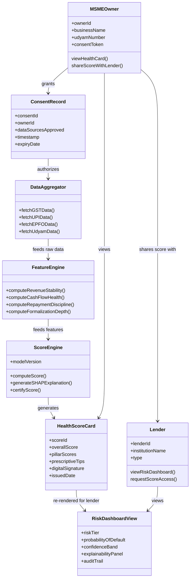
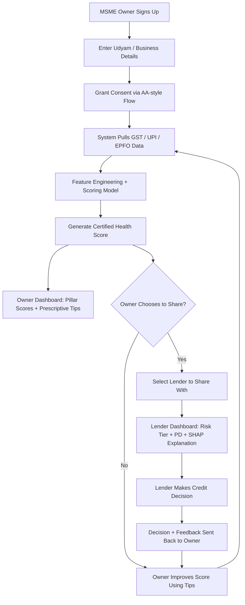

# MSME Financial Health Card
### A Portable, Dual-View, Explainable Credit Score for MSMEs

---

## 1. The Elevator Pitch (30 seconds)

> "Banks reject millions of viable MSMEs not because they're bad businesses, but because they're invisible to traditional credit systems. We're building a **certified financial health score** computed once from alternate data (GST, UPI, EPFO, Udyam) via the Account Aggregator framework — but unlike existing scoring tools that are built *for* banks and hidden *from* borrowers, ours shows the **same certified score to both sides**: the MSME owner sees a prescriptive health report telling them exactly how to improve it, and the lender sees a risk dashboard with full explainability. It's designed to sit as a **neutral, portable layer within India's ULI/OCEN ecosystem** — infrastructure any lender could plug into, not a proprietary black box competing with them."

---

## 2. The Problem

- India's MSME credit gap is estimated at **₹25–30 lakh crore (~$300B+)**, with only **~14% credit penetration** — far behind China (37%) and the US (50%).
- Of **6.19 crore Udyam-registered MSMEs, over 99% are micro-enterprises** — the segment with the thinnest financial documentation and highest rejection rates.
- Rich alternate data exists (GST, UPI, Account Aggregator, EPFO) but there's **no unified, standardized, explainable framework** to turn it into a trustworthy score both a bank and a borrower can rely on.
- RBI's **Unified Lending Interface (ULI)** has moved from pilot to live infrastructure — 64 lenders and 136 data services live as of Dec 2025 — meaning the *plumbing* for this idea already exists nationally; what's missing is the standardized scoring layer on top of it.

---

## 3. The Core Idea — What Makes This Different

| Existing players (Jocata, Perfios, FinBox, CRIF) | This project |
|---|---|
| Score built **for the bank**, invisible to the borrower | **Same certified score, visible to both** — owner and lender |
| Black-box risk number | **Explainable** (SHAP-based) + **prescriptive** (tells the owner *how* to improve) |
| Proprietary, locked to whichever bank runs it | **Portable** — one certified score the owner can present to any lender |
| Business incentive: deepen bank lock-in | Positioned as **neutral DPI-style infrastructure** (like UPI), not a competing product |

The key insight: incumbents structurally *won't* build the borrower-facing, portable version — a portable score reduces their paying customer's (the bank's) lock-in leverage. That's not a resourcing gap you can out-execute; it's a business-model conflict you can sidestep by positioning this as infrastructure, not a rival product.

---

## 4. UML — Simplified Class Diagram

---

## 5. User Flow

---

## 6. Phase-Wise Implementation Plan (from absolute scratch)

### Phase 0 — Foundations (Weeks 1–4)
- Learn Python data stack: pandas, numpy, matplotlib, scikit-learn basics
- Study credit risk fundamentals (what "default," "PD," "AUC-ROC" actually mean)
- Read RBI/SIDBI MSME reports and ULI/AA/OCEN documentation to understand the ecosystem you're plugging into
- Study 2–3 Kaggle credit-risk notebooks (e.g., Home Credit Default Risk) — rebuild them yourself, don't just read
- Study Jocata/Perfios public materials for context (not to copy — to know exactly what you're differentiating from)

**Output:** working knowledge of the ML basics + a one-page ecosystem map (AA → ULI → OCEN → your layer)

### Phase 1 — Data Foundation (Weeks 5–8)
- Design a synthetic dataset simulating GST filing patterns, UPI transaction velocity/volatility, EPFO contributions, Udyam registration completeness — grounded in patterns described in public RBI/SIDBI/ICRIER reports so it's realistic, not arbitrary
- Define your 4 scoring pillars and the raw features that feed each one
- Build a data cleaning/preprocessing pipeline

**Output:** a documented, realistic synthetic dataset + feature schema

### Phase 2 — Core Scoring Model (Weeks 9–14)
- Feature engineering per pillar
- Baseline model: logistic regression (interpretable, good starting benchmark)
- Upgrade to tree ensembles: Random Forest / XGBoost / LightGBM
- Handle class imbalance (SMOTE, class weighting) since defaults are rare
- Cross-validation, evaluate with AUC-ROC and precision-recall (report honestly — don't chase 90%)
- Build the weighted aggregate score from the 4 pillars

**Output:** a working scoring model with documented, honest performance metrics

### Phase 3 — Explainability + Prescriptive Layer (Weeks 15–18)
- Integrate SHAP for per-prediction explainability
- Build a rule-based mapping: weak feature → plain-language improvement tip
- Test that explanations are genuinely understandable to a non-technical business owner (this is a UX task, not just a technical one)

**Output:** every score comes with a "why" and a "what to do next"

### Phase 4 — Dual-View Platform (Weeks 19–26)
- Backend API (score computation, role-based endpoints) — FastAPI or Flask
- Owner dashboard (React) — health card visualization + prescriptive tips
- Lender dashboard (React) — risk tier, PD estimate, SHAP explainability panel, audit trail
- Mock AA/consent-flow simulation (since you won't have real AA access)
- Auth + role-based access control (owner sees prescriptive view only; lender sees risk view + audit trail only)

**Output:** a functioning end-to-end demo, not just a notebook

### Phase 5 — Trust & Compliance Layer (Weeks 27–32)
- Score certification: digital signing/hashing to simulate tamper-proof, verifiable scores
- Consent audit trail (what data was pulled, when, with what permission)
- Basic bias/fairness testing across synthetic segments (region, sector, business size)

**Output:** the layer that makes this defensible to a skeptical panel, not just functional

### Phase 6 — Testing & Refinement (Weeks 33–40)
- Build synthetic "personas" representing different MSME profiles and walk through the full flow with each
- If possible, get informal feedback from a CA, bank employee, or NBFC contact — even one conversation adds major credibility
- Polish UI/UX based on what's confusing

### Phase 7 — Documentation, Demo & Pitch Prep (Weeks 41–48)
- Deploy a live demo (any free-tier cloud hosting)
- Write up methodology clearly (this doubles as report material for college submission)
- Prepare a demo video + slide deck
- Target relevant hackathons (bank/fintech-run MSME challenges) for external validation beyond your college evaluation

*(~11 months total — compress Phases 0–1 if you already know some Python, or extend Phase 6 if you want deeper validation.)*

---

## 7. Pros, Cons, and Scope — Full Picture

### Pros
- Maps onto a real, currently-scaling national initiative (ULI/AA/OCEN) — not a hypothetical problem
- Genuine differentiation: dual-view, portable, prescriptive — a structurally different value proposition from funded incumbents, not just a feature tweak
- Strong "financial inclusion" narrative that aligns with the actual policy goal, useful for both grades and interviews
- B2B/B2B2C framing gives a plausible real monetization path (unlike consumer apps competing with free tools)
- Rich hackathon/grant ecosystem to plug into for external validation
- Skills gained (applied ML, explainability, fintech domain knowledge, system design) are high-demand and hard to fake in an interview

### Cons
- No real access to GST/UPI/AA/EPFO data — results are demonstrated on synthetic/public data, and you must be upfront about that limitation
- Steep combined learning curve: ML + financial domain knowledge simultaneously
- Less visually "wow" than a live map-based demo — the dashboard/explainability layer needs real design effort to land well
- Slower feedback loop — no easy way to get "real users" testing it the way a consumer app would
- Regulatory concepts (DPDP Act, AA consent architecture) are a genuine extra layer to learn

### Scope Boundaries (be explicit about these with your mentor)
- **In scope:** scoring methodology, explainability, prescriptive engine, dual-view dashboard, mock AA/consent simulation, synthetic data validation
- **Out of scope (and say so proactively):** real bank data integration, actual regulatory certification, production-grade security/compliance, real default-rate validation at 90% accuracy
- Owning this boundary clearly *before* a panelist points it out is what turns "this has gaps" into "this person understands exactly what a student project can and can't prove."

### Future Scope (good closing note for a pitch)
- Real-data pilot with an NBFC/MFI innovation lab or fintech accelerator
- Extend to underserved sub-segments: gig workers, women entrepreneurs, agri-MSMEs
- Formal positioning as a "Loan Service Provider"-style layer within the OCEN ecosystem
- Vernacular-language, WhatsApp/IVR-based access layer for owner-side reach in tier-3/4 towns

---

## 8. Reaching Real Users/Testers (for your demo, not full GTM)

You don't need real distribution channels working for a college project — but naming them in your pitch shows you understand this is a distribution problem, not just a model:
- Local GST filing agents / CAs (natural trust + data touchpoint)
- Common Service Centres (CSCs) — already handle Udyam registration
- NBFC/MFI loan officers as an embedded channel
- WhatsApp/IVR interface instead of assuming app discovery

