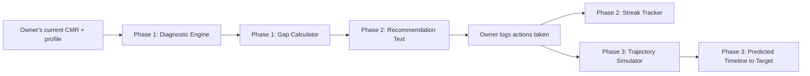

# Project Walkthrough — Everything Built So Far

A plain-language explanation of what this project does, why it's built this way, and the actual code behind each piece. Use this to explain the project to your mentor, a panel, or anyone else — it's written to be read start to finish.

---

## The Big Picture

MSMEs (small businesses) in India often get rejected for loans because of a low **CIBIL MSME Rank (CMR)** — a business credit score from 1 (best) to 10 (worst). Most business owners have no idea *why* their score is low or *what specifically* to fix. This app is a coach: it looks at a business's credit situation, explains exactly what's dragging the score down, tells the owner what to do about it in priority order, lets them track their progress, and predicts when they'll likely hit the score they need.

**Important: this app never creates or replaces an official credit score.** Only 4 RBI-licensed companies (CIBIL, Experian, Equifax, CRIF High Mark) are legally allowed to do that. This app interprets and coaches around a business's *existing* score — like a fitness coach doesn't replace your doctor, but helps you act on what the doctor told you.

## The Journey — Why the Idea Changed

The project didn't start here. It began as a bigger idea: a dual-sided platform showing both banks and business owners a shared alternate-data credit score built from GST, UPI, and EPFO data. After talking it through with a mentor, we realized that idea would require becoming (or partnering with) a licensed credit bureau — not realistic for a student project. So we pivoted to something narrower but far more buildable: a **coaching tool around an existing score**, rather than a competing score itself. This is a normal and healthy part of real project development — recognizing a blocker early and redesigning around it is a stronger story than pretending the blocker doesn't exist.

---

## Phase 0 — Learning the Basics

Before writing any real project code, we spent time learning the tools needed: Python's data libraries (pandas, numpy, scikit-learn), and the vocabulary of credit risk (default, probability of default, AUC-ROC, class imbalance). We practiced this on a small synthetic dataset, comparing a simple model (Logistic Regression) against a more complex one (Random Forest) — and learned a real lesson doing it: with very little data, the simpler model actually performed better, because the complex one didn't have enough examples to learn from reliably.

---

## Phase 1 — The Diagnostic Engine

**In plain language:** this is the part that looks at a business's credit situation and breaks it down into "here's exactly what's helping you, and here's exactly what's hurting you." It's built on four factors that are publicly known to matter for a CMR-style score:

| Factor | Weight (our assumption) | What it means |
|---|---|---|
| Payment history | 40% | Have they paid on time? |
| Credit utilization | 25% | How much of their available credit are they using? |
| Credit tenure | 20% | How long have they had credit accounts? |
| Firm profile | 15% | Business age and industry risk level |

**Important honesty point:** the real CMR formula is a secret owned by CIBIL. Nobody outside the company knows the exact weights. What *is* publicly known is roughly which factors matter and in what order of importance — so this engine is a **reasonable, transparent approximation**, not a copy of the real formula. We say this openly rather than pretending otherwise.

Each factor gets turned into a 0-100 sub-score using simple, explainable rules. For example, here's how credit utilization is scored:

```python
def score_credit_utilization(profile: BusinessCreditProfile) -> float:
    """Piecewise: <=30% is ideal, 60% is the healthy ceiling, 75%+ is a red flag."""
    u = profile.credit_utilization
    if u <= 0.30:
        score = 100
    elif u <= 0.60:
        score = 100 - (u - 0.30) / 0.30 * 20        # 100 -> 80
    elif u <= 0.75:
        score = 80 - (u - 0.60) / 0.15 * 30          # 80 -> 50
    else:
        score = 50 - min((u - 0.75) / 0.25, 1) * 50  # 50 -> 0 at 100% utilization
    return max(0, min(100, score))
```

The four sub-scores get combined (using the weights above) into one overall score, which maps to an estimated rank 1-10:

```python
def compute_overall_diagnostic(profile: BusinessCreditProfile) -> dict:
    factor_scores = {name: fn(profile) for name, fn in FACTOR_FUNCTIONS.items()}
    overall_score = sum(factor_scores[name] * WEIGHTS[name] for name in WEIGHTS)
    estimated_rank = 10 - min(int(overall_score // 10), 9)
    return {
        "factor_scores": factor_scores,
        "overall_score": round(overall_score, 1),
        "estimated_cmr_rank": estimated_rank,
    }
```

We then built a **gap calculator** — given a current rank and a target rank (e.g., "I'm at rank 6, I need rank 3 for this loan"), it ranks which factors have the most room for improvement. We tested this on 5 realistic example businesses and found a real bug: raw "improvement headroom" isn't enough — some factors with big headroom (like credit tenure) simply can't be improved quickly, no matter how much room there is. So we added an **actionability weight**, which favors fast-moving factors (like utilization) over slow ones (like tenure) when deciding what to recommend first:

```python
ACTIONABILITY_WEIGHT = {
    "payment_history": 0.6,
    "credit_utilization": 1.0,
    "credit_tenure": 0.15,
    "firm_profile": 0.15,
}
```

**Real result this caught:** for a business with mediocre-but-not-terrible everything, the engine was initially recommending "improve your firm profile" first — technically the biggest theoretical gap, but not something the owner can actually act on. After the fix, it correctly recommends utilization and payment history first, since those can actually be improved this month.

---

## Phase 2 — Action Plan + Self-Logging

**In plain language:** Phase 1 tells you *what's* wrong. Phase 2 tells you *what to do about it in plain English*, and gives you a way to track that you're actually doing it — like a habit tracker for your credit score.

Each factor gets a specific, human-written recommendation based on the business's actual numbers (not generic filler text):

```python
def generate_recommendation_text(factor: str, profile: BusinessCreditProfile, sub_score: float) -> str:
    if factor == "credit_utilization":
        pct = round(profile.credit_utilization * 100)
        if profile.credit_utilization > 0.75:
            return (
                f"Your credit utilization is {pct}%, well above the 75% danger threshold. "
                "Pay down balances or request a credit limit increase to get under 60% — "
                "this is your fastest lever, results can show within a single billing cycle."
            )
        # ... (similar logic for the other ranges and other 3 factors)
```

For the self-logging piece, the owner records actions they've actually taken ("paid down my credit card by ₹15,000," "set up autopay"), and the app tracks a **streak** — consecutive weeks with at least one logged action, which breaks if they miss a week:

```python
def compute_streak_weeks(owner_id: str) -> int:
    """Consecutive calendar weeks with at least one logged action."""
    actions = get_actions(owner_id)
    if not actions:
        return 0
    weeks_with_activity = {
        datetime.fromisoformat(a["logged_at"]).isocalendar()[:2] for a in actions
    }
    most_recent = max(weeks_with_activity)
    streak = 0
    current = datetime.fromisocalendar(*most_recent, 1)
    while (current.isocalendar()[0], current.isocalendar()[1]) in weeks_with_activity:
        streak += 1
        current -= timedelta(weeks=1)
    return streak
```

This data is stored in a real, persistent database (SQLite) — not just kept in memory — so it survives between sessions, the same way a real app would need to.

---

## Phase 3 — Trajectory Prediction

**In plain language:** this is the "when will I actually get there?" piece. Given the business's current numbers and what they've actually been doing (from their Phase 2 logs), it projects forward month by month and estimates when they'll likely hit their target rank.

This has two layers, and it's important to understand why there are two:

**Layer 1 — the simulator (the real answer).** This walks forward month by month, using the *same* transparent formulas from Phase 1, applying small realistic improvements each month if the owner keeps logging effort on a factor:

```python
def simulate_trajectory(profile, monthly_effort, months):
    current = dataclasses.replace(profile)  # work on a copy
    trajectory = [{"month": 0, **compute_overall_diagnostic(current)}]
    months_of_clean_payment_effort = 0

    for month in range(1, months + 1):
        current.credit_tenure_years += 1 / 12   # time passes regardless of effort
        current.business_age_years += 1 / 12

        if monthly_effort.get("credit_utilization"):
            current.credit_utilization = max(0.30, current.credit_utilization - 0.08)

        if monthly_effort.get("payment_history"):
            months_of_clean_payment_effort += 1
            current.on_time_payment_pct = min(1.0, current.on_time_payment_pct + 0.03)
            if current.has_recent_delinquency and months_of_clean_payment_effort >= 3:
                current.has_recent_delinquency = False

        trajectory.append({"month": month, **compute_overall_diagnostic(current)})
    return trajectory
```

**Layer 2 — a trained regression model (a secondary check).** We generated 3,000 synthetic scenarios using the simulator above, then trained a Random Forest model on that data to see if it could learn to predict outcomes on its own. It achieved 93% accuracy (R²) at approximating the simulator — which is a genuine machine learning result, but it's important to be precise about what it proves: **it shows the model successfully learned our simulator's own logic — it does not prove real-world accuracy**, since there's no real historical CMR data available to validate against. We say this plainly rather than overselling it.

**A genuinely interesting result from testing this:** for a struggling example business, working on *both* utilization and payment history reached the target rank in just 4 months. But working on utilization *alone* never reached the target, even after 24 months — because payment history (40% of the weight) never improved. This matches real credit-scoring wisdom: payment history matters most, and fixing one thing while ignoring the biggest factor has real limits.

---

## How It All Connects



Everything is exposed as real, working API endpoints (built with FastAPI), testable live at `/docs` when the server is running:

- `GET /owner/diagnostic/{id}` — the factor breakdown
- `GET /owner/action-plan/{id}` — prioritized recommendations with advice text
- `POST /owner/log-action/{id}` — record an action taken
- `GET /owner/streak/{id}` — current logging streak
- `GET /owner/prediction/{id}` — projected timeline, based on real logged behavior

## What's Actually Proven, Not Just Built

- Tested against 5 distinct business scenarios, catching and fixing a real bug (headroom vs. actionability) along the way
- Verified the prediction endpoint responds correctly to real logged behavior — genuinely different answers before and after logging actions, not a static number
- Regression model trained and validated (R²=0.93) with an honest explanation of what that number does and doesn't mean
- Every design decision (weights, thresholds, speeds) is documented in code comments, not buried assumptions

## What's Left

- **Phase 4 (stretch goal):** using GST/UPI trend data as early supplementary signals
- **Phase 5:** getting a real MSME owner or CA to actually test this with their real numbers — the biggest advantage of this pivot over the original idea
- **Phase 6:** frontend UI, polish, demo video, and hackathon/pitch prep
