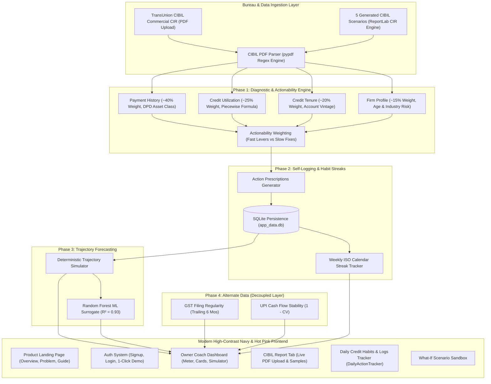

# Project Walkthrough — Complete Architecture & Implementation

A plain-language explanation of what this project does, why it is built this way, and the exact code behind each component. Use this document to explain the project to mentors, review panels, or pitch evaluators.

---

## 1. Executive Summary & Core Value Proposition

In India, MSMEs face a **₹25–30 lakh crore credit gap**, with formal credit penetration hovering around 14%. When an enterprise applies for a commercial bank loan or working capital line, lenders evaluate the company's **CIBIL MSME Rank (CMR)** — a business credit rank scaled from **1 (lowest risk / best)** to **10 (highest risk / distressed)**. This is distinct from the promoter's personal CIBIL score.

Most MSME owners who receive an unfavorable rank (e.g. CMR-6 to CMR-8) receive only a rejection letter, with zero visibility into:
1. *Why* their business was rated that way.
2. *Which specific factors* are hurting their rank.
3. *How long* it will realistically take to reach bank eligibility (typically CMR-3).

### Legal & Regulatory Compliance (CICRA 2005)
Under the **Credit Information Companies Regulation Act (CICRA), 2005**, only 4 RBI-licensed Credit Information Companies (TransUnion CIBIL, Experian, Equifax, CRIF High Mark) are authorized to calculate and issue official credit scores. 
**Our platform never issues or computes a competing score.** Like a personal fitness coach who reviews medical diagnostic reports and prescribes workouts without claiming to be a doctor, our platform interprets official bureau factors, guides actionable habits, and projects the time needed to qualify for formal bank credit.

---

## 2. Technical Stack & Component Architecture



---

## 3. The Implementation Journey (Phases 0 Through 6)

### Phase 0 — Foundations & Credit Risk Machine Learning
- Established the mathematical vocabulary of credit risk: Probability of Default (PD), Days Past Due (DPD), asset classification, and class imbalance.
- Explored synthetic credit datasets in [`ml/notebooks/00_phase0_python_basics.py`](file:///C:/Users/Kanav/.gemini/antigravity/scratch/msme-financial-health-card/ml/notebooks/00_phase0_python_basics.py), verifying that simple interpretable models often outperform over-parameterized models on small MSME cohorts.

---

### Phase 1 — Transparent Diagnostic & Actionability Engine
Implemented in [`ml/src/feature_engineering.py`](file:///C:/Users/Kanav/.gemini/antigravity/scratch/msme-financial-health-card/ml/src/feature_engineering.py):
- **4 Documented Public Bureau Factors**:
  - **Payment History (40%)**: Scaled 0–100. Any delinquency in the last 90 days applies a 20-point deduction.
  - **Credit Utilization (25%)**: Piecewise continuous curve ($\le 30\%$ is ideal; $30\%\text{--}60\%$ is healthy; $>75\%$ is a danger flag).
  - **Credit Tenure (20%)**: Linearly rewards account vintage up to 10 years.
  - **Firm Profile (15%)**: Business operating age modulated by an industry risk multiplier (`low: 1.0`, `medium: 0.85`, `high: 0.65`).
- **The "Actionability Weight" Discovery**:
  Early versions ranked advice purely by *score headroom* ($[100 - \text{sub-score}] \times \text{weight}$). This resulted in advising young businesses to "increase business age" or "build tenure" — which cannot be sped up.
  We introduced **Actionability Weights**:
  - `credit_utilization`: **1.0** (can be fixed within 1 billing cycle)
  - `payment_history`: **0.6** (takes 3 months of consistent clean payments)
  - `credit_tenure`: **0.15** (only advances as time passes)
  - `firm_profile`: **0.15** (mostly fixed)

---

### Phase 2 — Prescriptive Action Plan & Habit Streak Tracking
Implemented in [`backend/app/core/logging_store.py`](file:///C:/Users/Kanav/.gemini/antigravity/scratch/msme-financial-health-card/backend/app/core/logging_store.py):
- Translates factor deficits into plain-English advice tailored to the business's actual numbers.
- **Weekly Habit Streak**: Calculates consecutive ISO calendar weeks (Monday–Sunday) with verified borrower actions (e.g. balance paydown, NACH mandate activation). A single missed week breaks the streak, driving the behavioral consistency required for credit repair.

---

### Phase 3 — Dual-Layer Trajectory Forecasting
Implemented in [`ml/src/trajectory_simulator.py`](file:///C:/Users/Kanav/.gemini/antigravity/scratch/msme-financial-health-card/ml/src/trajectory_simulator.py) and [`ml/src/trajectory_model.py`](file:///C:/Users/Kanav/.gemini/antigravity/scratch/msme-financial-health-card/ml/src/trajectory_model.py):
- **Layer 1: Deterministic Simulator (Ground Truth)**:
  - Advances natural time clocks each month: `credit_tenure += 1/12`, `business_age += 1/12`.
  - Simulates active utilization effort: **-8% per month** down to a 30% floor.
  - Simulates clean payment effort: **+3% per month**, and recent delinquency **ages out after 3 clean months**.
  - *Key Finding*: Fixing utilization alone without curing payment delinquencies will cap an enterprise at CMR-4 or 5.
- **Layer 2: Random Forest ML Surrogate**:
  - Trained on 3,000 synthetic simulation runs ($R^2 \approx 0.93$, $\text{MAE} \approx 1.5$). Validates that the surrogate has learned the simulator's logic for fast querying.

---

### Phase 4 — Decoupled Alternate Data Signals
Implemented in [`ml/src/alternate_data.py`](file:///C:/Users/Kanav/.gemini/antigravity/scratch/msme-financial-health-card/ml/src/alternate_data.py):
- Aggregates trailing 6-month GST filing regularity and UPI cash flow stability.
- **Compliance Boundary**: Explicitly kept decoupled from the core CMR calculation, acting as an early cash-flow signal before monthly bureau files update.

---

### Phase 5 — Testing Kit, Interactive CLI, & 5 Archetypes
Implemented in [`ml/notebooks/demo_cli.py`](file:///C:/Users/Kanav/.gemini/antigravity/scratch/msme-financial-health-card/ml/notebooks/demo_cli.py) and [`docs/PHASE5_TESTING_KIT.md`](file:///C:/Users/Kanav/.gemini/antigravity/scratch/msme-financial-health-card/docs/PHASE5_TESTING_KIT.md):
- Provides an interview script and interactive CLI for testing with real Chartered Accountants (CAs) and MSME business promoters.
- Calibrated 5 diverse scenarios:
  1. *Struggling Turnaround* (CMR-6, 78% Util, Recent Delinquency)
  2. *Healthy Growth* (CMR-2, 45% Util, 8-yr Tenure)
  3. *Thin-File Startup* (CMR-4, 20% Util, 0.5-yr Tenure)
  4. *Maxed-Out Utilization* (CMR-3, 95% Util, 9-yr Tenure)
  5. *Consistently Mediocre* (CMR-4, 55% Util, 4-yr Tenure)

---

### Phase 6 — Frontend Overhaul, CIBIL Ingestion, & Auth System

#### 1. TransUnion CIBIL Report PDF Generator & Ingestion Engine
- **Why It Was Built**: Bureau APIs require institutional bank contracts costing lakhs. Real businesses already receive official CIBIL CIR PDF reports.
- **Generator ([`cibil_generator.py`](file:///C:/Users/Kanav/.gemini/antigravity/scratch/msme-financial-health-card/backend/app/core/cibil_generator.py))**:
  - Uses `reportlab` to generate authentic TransUnion CIBIL Commercial Credit Information Reports for all 5 scenarios.
  - Matches official CIBIL layouts: Report Control Numbers (RCN), entity master, CMR score box, aggregate limits, and 12-month Days Past Due (DPD) repayment tracks (`000 000 030 ...`).
- **Parser ([`cibil_parser.py`](file:///C:/Users/Kanav/.gemini/antigravity/scratch/msme-financial-health-card/backend/app/core/cibil_parser.py))**:
  - Uses `pypdf` to extract RCN, company identity, official CMR rank, credit utilization ratio, DPD delinquency conduct, and credit vintage.
  - Auto-populates the diagnostic engine directly from uploaded documents.

#### 2. Modern High-Contrast Navy & Hot Pink Visual Theme
- **Background**: Deep navy (`#0F1B3D`).
- **Cards & Surfaces**: Sleek navy (`#15244E`) with subtle containers (`#122045`) and crisp navy borders (`#21356B`).
- **Typography**: Warm light beige / soft ivory white (`#FAF7F2`) for primary headings, soft pearl silver (`#CBD5E1`) for secondary text.
- **Accents & Contrast**: Hot Pink (`#FF3D8B`) for high-contrast primary CTAs, active navigation tabs, flame habit streaks, and top-priority action badges.

#### 3. Educational Landing Page ([`LandingPage.jsx`](file:///C:/Users/Kanav/.gemini/antigravity/scratch/msme-financial-health-card/frontend/src/components/LandingPage.jsx))
- Explains the ₹25–30 Lakh Crore credit gap, personal CIBIL vs commercial CMR, the 4-step coaching mechanism, and a 4-step user guide for MSME owners.

#### 4. Authentication & Quick Demo System ([`AuthPage.jsx`](file:///C:/Users/Kanav/.gemini/antigravity/scratch/msme-financial-health-card/frontend/src/components/AuthPage.jsx) & [`auth.py`](file:///C:/Users/Kanav/.gemini/antigravity/scratch/msme-financial-health-card/backend/app/routers/auth.py))
- Sign In & Business Registration forms backed by SQLite with SHA-256 hashed passwords.
- **One-Click Instant Demo Login**: Allows evaluators to immediately access the platform as *Sharma Precision Engineering* without filling out credentials.

#### 5. Interactive CIBIL Report Tab ([`CibilReportTab.jsx`](file:///C:/Users/Kanav/.gemini/antigravity/scratch/msme-financial-health-card/frontend/src/components/CibilReportTab.jsx))
- Drag-and-drop PDF upload zone.
- Downloadable official sample CIBIL PDFs for all 5 archetypes.
- One-click "Load & Parse" buttons and parsed data inspection cards.

---

### Phase 7 — Borrower-Centric Pivot: Score Clarity, Multi-Step Playbooks & Daily Logs

#### 1. Complete Removal of Lender Audit
- **Why**: MSME promoters are overwhelmed by underwriting jargon like Probability of Default (PD) and risk matrices. Removing the lender audit section transforms the product into an empathetic, supportive borrower coach.
- **Decommissioned**: Removed `backend/app/routers/lender.py`, deleted `LenderView.jsx`, and decoupled all lender-facing API routes.

#### 2. Daily Habits & Micro-Action Tracker ([`DailyActionTracker.jsx`](file:///C:/Users/Kanav/.gemini/antigravity/scratch/msme-financial-health-card/frontend/src/components/DailyActionTracker.jsx))
- **Daily Financial Hygiene Checklist**: 5 high-impact daily habits with localStorage persistence:
  1. *Monitor Overdraft / Credit Limit Balances* (< 60% ceiling before bureau snapshots).
  2. *Verify Account Balance for Upcoming NACH Mandates* (48 hrs before EMI auto-debit).
  3. *Settle Trade Payables & Invoices On-Time* (protect commercial trade credit history).
  4. *Sweep Surplus Daily Collections to CC/OD Account* (immediate utilization reduction).
  5. *Audit Bureau Statement for Inaccurate DPD Tags* (dispute outdated overdue flags).
- **1-Click Preset Logger**: Instant action logging for bank transfers, limit expansion requests, and clean EMI payments.
- **Action History Timeline**: Category filtering, streak counter, and single-record deletion.

#### 3. Structured Multi-Step Factor Cards ([`FactorCard.jsx`](file:///C:/Users/Kanav/.gemini/antigravity/scratch/msme-financial-health-card/frontend/src/components/FactorCard.jsx))
- Upgraded beyond generic recommendations to a 3-tier concrete playbook:
  - ⚡ **7-Day Quick Win**: High-speed action to implement this week.
  - 🎯 **30–90 Day Target**: Sustainable milestone to lock in higher points.
  - ⚠️ **Mistakes to Avoid**: Traps like closing oldest credit lines or maxing out lines before cutoffs.
- **1-Click Quick Win Record**: Records the factor's quick win directly into SQLite and recalculates streaks and trajectories.

---

### Phase 6 — CIBIL CIR Integration, Dummy Data Removal & Clean Placeholders
- **Removal of Hardcoded Archetypes**:
  - Eliminated mock business datasets (`Sharma Precision Engineering`, `Patel Textiles`, `Apex Machining`, `Greenfield Agro`, `City Logistics`) from active backend and frontend states.
  - Cleared synthetic action logs from SQLite persistent database (`backend/app/core/app_data.db`).
  - Removed "One-Click Demo Access" buttons that previously injected hardcoded profiles.
- **Framework Preservation & Clean Placeholder States**:
  - **Radial Score Meter (`ScoreGauge`)**: Seamlessly renders `--` and an `"Awaiting CIR Report"` neutral state when unranked, rather than defaulting to arbitrary numbers.
  - **Factor Diagnostic Cards (`FactorCard`)**: Displays `"--/100"` and `"Pending Data"` while preserving the 3-tier actionable playbooks (Quick Win, 90-Day Milestone, Mistakes to Avoid) so MSME owners immediately learn high-leverage habits.
  - **Rank Trajectory Forecast (`TrajectoryChart`)**: Displays a clean empty state card prompting the borrower to log weekly actions or upload their CIR report.
  - **Active Profile & Navbar**: Defaults to `"My Business"` or registered business trade name with an `"Unranked"` pill until a report is uploaded or an account is initialized.
  - **CIBIL Report Tab**: Fully preserves official PDF ingestion and sample downloads without polluting active business state.

---

## 4. REST API Endpoint Index

| Router | Method | Endpoint | Description |
|---|---|---|---|
| **Auth** | `POST` | `/auth/signup` | Register new MSME business account with phone & email |
| **Auth** | `POST` | `/auth/login` | Authenticate owner via either phone or email using same password |
| **Auth** | `POST` | `/auth/demo-login` | Instant demo login for evaluation |
| **Auth** | `GET` | `/auth/me/{id}` | Fetch current user session details |
| **CIBIL** | `POST` | `/cibil/upload/{owner_id}` | Upload and parse official CIBIL PDF |
| **CIBIL** | `GET` | `/cibil/samples` | List official sample CIBIL reports |
| **CIBIL** | `GET` | `/cibil/download-sample/{id}` | Download sample CIBIL CIR PDF |
| **CIBIL** | `POST` | `/cibil/load-sample/{owner_id}/{id}` | One-click load sample scenario onto profile |
| **Owner** | `GET` | `/owner/profiles` | List all available MSME business profiles |
| **Owner** | `GET` | `/owner/diagnostic/{id}` | Factor-by-factor breakdown and CMR rank |
| **Owner** | `GET` | `/owner/action-plan/{id}` | Actionability-prioritized recommendation list |
| **Owner** | `POST` | `/owner/log-action/{id}` | Record verified borrower improvement action |
| **Owner** | `DELETE` | `/owner/action/{action_id}` | Delete a single logged action record |
| **Owner** | `POST` | `/owner/reset-history/{id}` | Reset action history and streak |
| **Owner** | `GET` | `/owner/streak/{id}` | Active weekly habit streak |
| **Owner** | `GET` | `/owner/prediction/{id}` | Month-by-month trajectory forecast |
| **Owner** | `POST` | `/owner/simulate-what-if/{id}`| Dynamic what-if sandbox simulation |

---

## 5. Verification & Running the Project

### Running Backend (FastAPI)
```bash
cd backend
python -m uvicorn app.main:app --host 127.0.0.1 --port 8000
```
API Documentation: `http://127.0.0.1:8000/docs`

### Running Frontend (React + Vite)
```bash
cd frontend
npm install
npm run dev
```
Application URL: `http://localhost:5173/`
